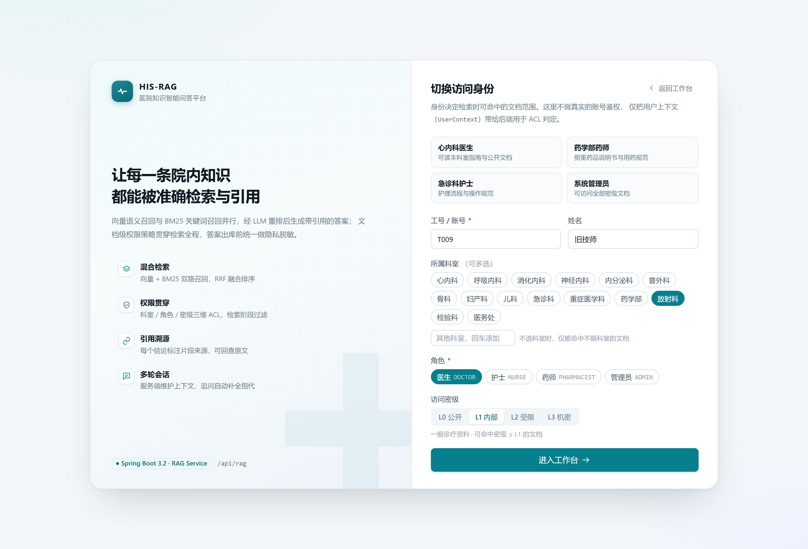
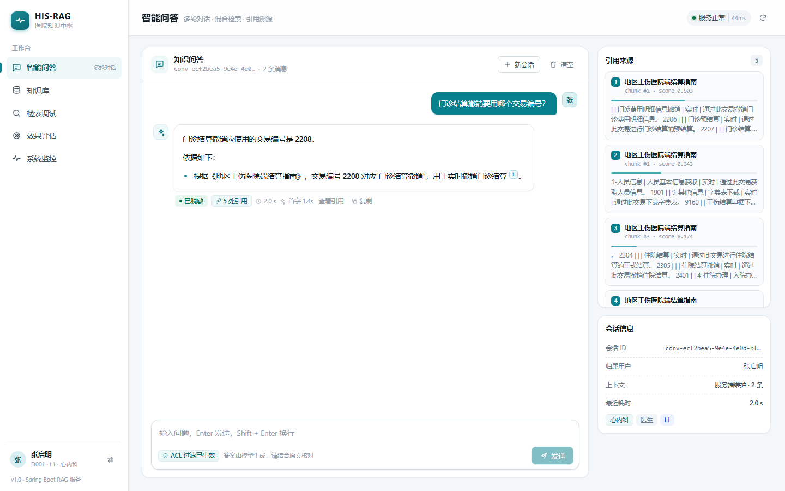
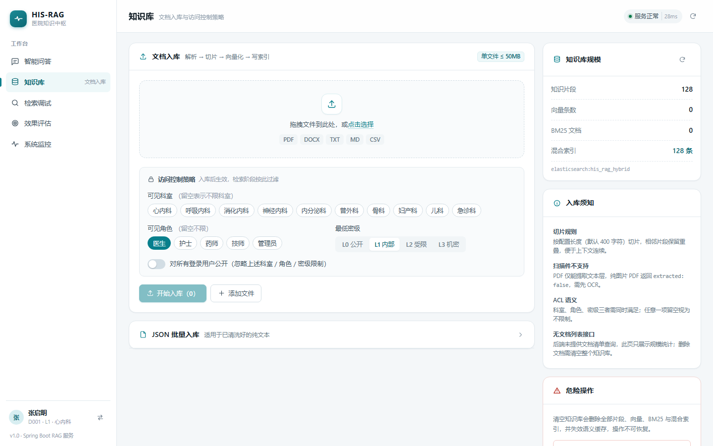
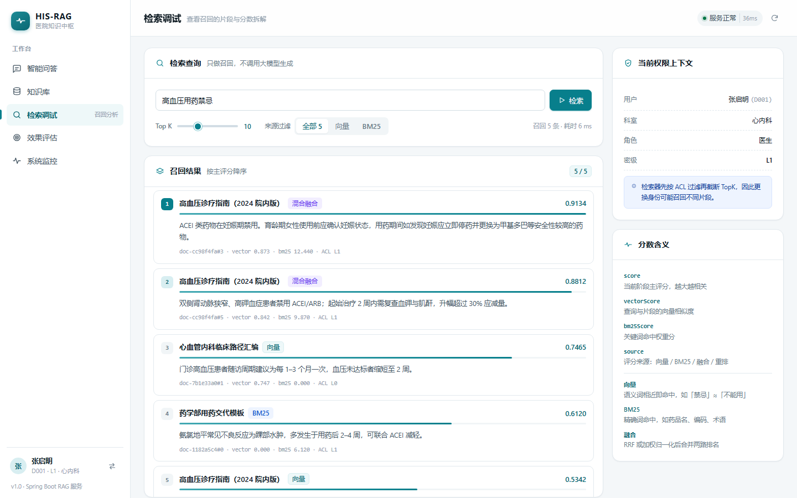
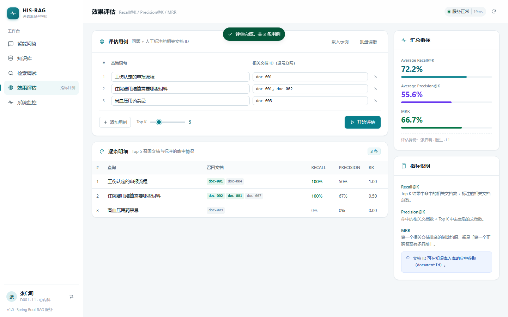
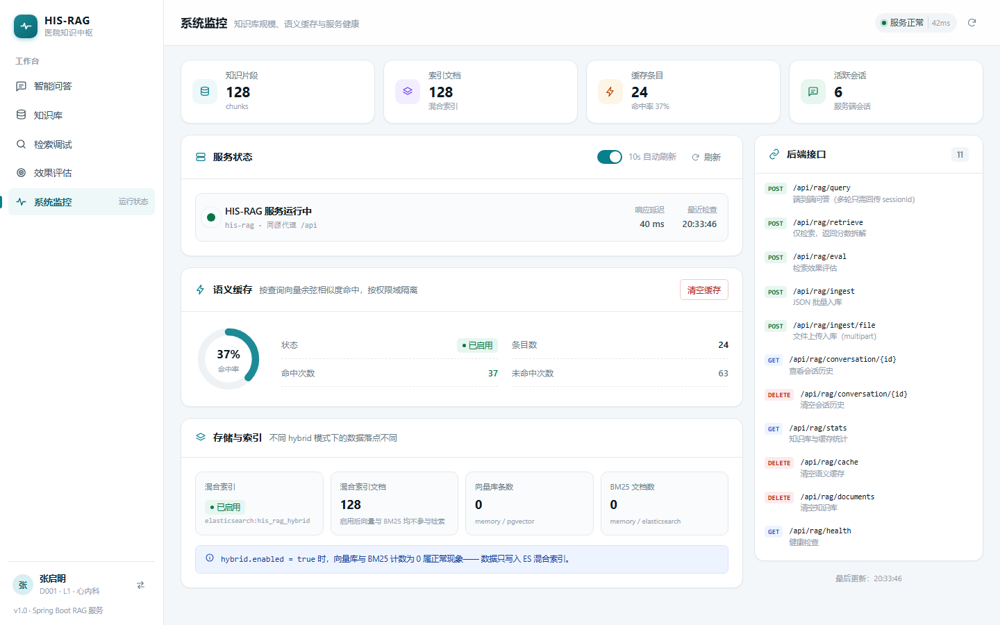
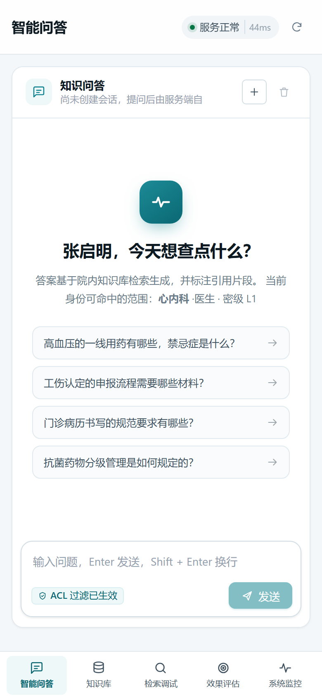

# HIS-RAG Web

医院知识智能问答系统的前端，配套后端 [`HIS-RAG`](https://github.com/WU-CODE97/HIS-RAG)（Spring Boot 3.2 + Java 17）。

基于 **Vue 3 + Vite + Pinia + Vue Router**，零 UI 组件库依赖（设计系统自建），覆盖问答、知识库、检索调试、效果评估、系统监控五个工作台页面。

---

## 快速开始

```bash
# 0. 克隆两个仓库到同一父目录（保持 ../HIS-RAG 的相对布局）
git clone https://github.com/WU-CODE97/HIS-RAG.git
git clone https://github.com/WU-CODE97/HIS-RAG-WEB.git his-rag-web

# 1. 先启动后端（默认 8080）
cd ../HIS-RAG && mvn spring-boot:run

# 2. 启动前端
cd ../his-rag-web
npm install
npm run dev          # http://127.0.0.1:5173
```

首次进入需要设置**访问身份**（工号 / 科室 / 角色 / 密级）——这不是账号登录，而是把
`UserContext` 带给后端用于文档级 ACL 判定；页面提供 4 个预设身份可一键填入。

> 后端默认 `rag.hybrid.backend=elasticsearch`，需要本地 ES；
> 想零依赖跑通可 `RAG_HYBRID_BACKEND=local mvn spring-boot:run`。

### 环境变量

复制 `.env.example` 为 `.env.local` 后按需修改：

| 变量 | 作用 | 默认 |
|---|---|---|
| `VITE_PROXY_TARGET` | 开发代理目标 | `http://localhost:8080` |
| `VITE_API_BASE` | 请求基地址，留空走同源 `/api` | 空 |

### 构建

```bash
npm run build        # 产物在 dist/
npm run preview      # 本地预览构建产物
```

---

## 界面预览

| 身份设置 | 智能问答（含引用溯源） |
|---|---|
|  |  |

| 知识库入库 | 检索调试 |
|---|---|
|  |  |

| 效果评估 | 系统监控 |
|---|---|
|  |  |

窄屏（≤720px）自动切换为底部导航，引用改为底部抽屉：

> 截图中的知识库数据来自本地 mock 服务，仅用于展示界面。

---

## 页面与接口映射

| 页面 | 路由 | 使用的后端接口 |
|---|---|---|
| 身份设置 | `/identity` | —（仅本地保存 `UserContext`） |
| 智能问答 | `/chat` | `POST /query/stream`（SSE，失败自动回退 `POST /query`）、`GET /conversation/{id}`、`DELETE /conversation/{id}` |
| 知识库 | `/knowledge` | `POST /ingest/file`、`POST /ingest`、`GET /stats`、`DELETE /documents` |
| 检索调试 | `/retrieve` | `POST /retrieve` |
| 效果评估 | `/evaluation` | `POST /eval` |
| 系统监控 | `/monitor` | `GET /stats`、`GET /cache/stats`、`GET /health`、`DELETE /cache` |

所有请求前缀 `/api/rag`，见 `src/api/rag.js`。

### 多轮会话的约定

后端历史由服务端按 `sessionId` 维护，**不接受客户端传 history**，因此前端：

1. 首轮不传 `sessionId`，从响应里取 `sessionId` 并写入 `localStorage`（按 `userId` 分键）；
2. 后续轮次只带 `sessionId`；
3. 页面刷新后调用 `GET /conversation/{sessionId}?userId=` 回填消息，恢复上下文；
4. 切换身份时丢弃旧 `sessionId`，避免串用他人会话；
5. 若携带他人 `sessionId`，后端返回 **403**，前端会自动重置会话并提示。

---

## 目录结构

```
his-rag-web/
├── index.html
├── vite.config.js          # /api 代理 → 8080
├── .env.example
└── src/
    ├── main.js
    ├── App.vue
    ├── router/index.js     # 无身份时拦截到 /identity
    ├── styles/main.css     # 设计令牌 + 基础组件样式
    ├── api/
    │   ├── http.js         # fetch 封装 + XHR 上传进度 + ApiError
    │   └── rag.js          # 全部 /api/rag 接口
    ├── stores/
    │   ├── identity.js     # 用户上下文（localStorage 持久化）
    │   └── chat.js         # 消息、sessionId、引用聚焦
    ├── composables/useToast.js
    ├── utils/
    │   ├── markdown.js     # 轻量 Markdown 渲染（含 [1] 引用角标）
    │   └── format.js       # 数字 / 时间 / 分数格式化、关键词高亮
    ├── components/
    │   ├── Icon.vue        # 内置 SVG 图标集
    │   ├── Modal.vue
    │   ├── CitationList.vue
    │   └── ToastLayer.vue
    ├── layouts/AppLayout.vue
    └── views/
        ├── IdentityView.vue
        ├── ChatView.vue
        ├── KnowledgeView.vue
        ├── RetrieveView.vue
        ├── EvalView.vue
        └── MonitorView.vue
```

---

## 交互设计要点

**智能问答**
- **流式渲染**：走 `POST /query/stream` 的 SSE，正文逐段到达即渲染，末尾带闪动光标；`meta` 事件在重排后立刻到达，引用面板比正文更早出现。首字通常 1~2 秒。
- 首字之前展示四段式进度（解析指代 → 混合检索 → 候选重排 → 生成脱敏）与已等待秒数；正文一开始就切换为内容渲染，不再让用户对着转圈等待。
- 后端未部署流式接口（404/405）时自动退回同步 `/query`，页面不会不可用。
- 答案按 Markdown 渲染（表格、列表、引用块），正文里的 `[1]` 变成可点击角标，点击后右侧「引用来源」定位到对应片段；窄屏改为底部抽屉。
- 每条答案标注：语义缓存命中 / 已脱敏 / 生成异常 / 引用数 / 端到端耗时 / **首字耗时** / 多轮改写后的检索语句。

**知识库**
- 拖拽或多选上传，逐文件显示上传进度与服务端返回的 `chunks`；`extracted=false` 明确提示「可能是扫描件，需 OCR」。
- ACL 表单（科室 / 角色 / 密级 / 公开）随文件一起提交，`departments` 与 `roles` 以重复字段而非逗号拼接发送，匹配后端 `List<String>` 绑定。
- 后端没有文档列表接口，因此页面只展示规模统计，并明确说明「删除文档需清空整个知识库」。

**检索调试**
- 结果按主评分降序，展示 `score` / `vectorScore` / `bm25Score` / `source` 四维信息与归一化分数条；正文高亮查询关键词。

**效果评估**
- 用例可逐条编辑或粘贴 JSON 批量导入，输出 Recall / Precision / MRR 与逐条命中明细（命中文档 ID 标绿）。

**系统监控**
- 健康检查 30s 轮询（顶栏常驻）、统计数据 10s 自动刷新可开关；缓存命中率用环形图 + 命中/未命中计数呈现。

---

## 部署

Nginx 反代示例（前后端同域，规避 CORS）：

```nginx
server {
    listen 80;
    server_name rag.hospital.example.com;

    root /var/www/his-rag-web/dist;
    index index.html;

    location / {
        try_files $uri $uri/ /index.html;   # history 路由
    }

    location /api/ {
        proxy_pass http://127.0.0.1:8080;
        proxy_set_header Host $host;
        proxy_set_header X-Real-IP $remote_addr;
        client_max_body_size 50m;            # 与后端 multipart 上限一致
    }
}
```

后端未配置 CORS，跨域部署时要么用上面的同域反代，要么在 `HIS-RAG` 里放行来源。

---

## 已知限制

- **身份非鉴权**：`UserContext` 由前端填写，仅用于演示 ACL 差异；生产环境应改为从登录态（JWT / 网关）解析后再注入。
- **流式兼容性**：SSE 用 `fetch` + `ReadableStream` 消费（`EventSource` 不支持 POST 请求体）。若前面挂的 Nginx 开了 `proxy_buffering`，需要对该路由关闭，否则分片会被攒在一起下发。
- **无文档清单**：后端未提供文档列表 / 单文档删除接口，知识库页只能展示统计与全量清空。
- **会话存于 localStorage**：`sessionId` 按 `userId` 持久化，清理浏览器数据即失去上下文恢复能力（服务端 TTL 默认 2h）。
